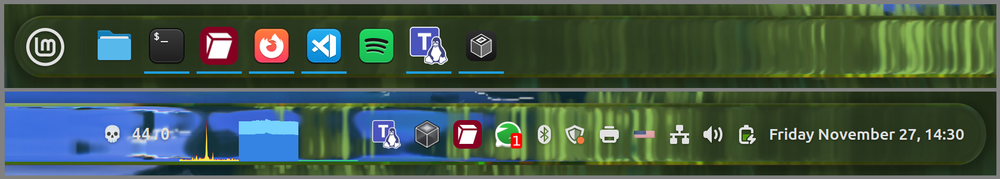

# Vitrin



A Cinnamon extension that makes panels float as rounded bars, with an optional Molten Quartz background. User documentation is in [vitrin/README.md](vitrin/README.md).

## Functionality
 * Lensing effect in Molten Quartz mode.
 * Automatically update glyph color when background content changes, to enhance readability.
 * High degree of customization. Change margins, corner rounding and lens shader effect to make it your own.

## Development

```sh
make install       # install like a Spice (copy into ~/.local/share/cinnamon/extensions) and reload it
make unit          # unit tests (Node 18+)
make validate      # the official validate-spice script
make integration   # virtual desktop tests
make test          # all of the above except install
```

## Integration tests

`tests/integration/run.py` starts, for every scenario, a private Xorg server using the dummy video driver, a private D-Bus session and a throwaway home directory, then runs Cinnamon in it. The desktop running the tests is never touched. Each scenario sets a resolution, scaling factor, panel layout, applets and Vitrin settings, and checks:

- the panel grows by the gap without changing its icon size, and stays attached to its edge
- the Molten Quartz or theme background is drawn: screen corners show the wallpaper, the bar tints it, corners are rounded
- hover, menu and attention highlights get the configured shape and colour
- clicks in the screen corners reach the first and last applet (or don't, when disabled)
- an auto-hiding panel hides instantly, or after the hide delay, when a window covers it, and returns when it closes
- settings changes apply live, and *Restore defaults* resets them, through the same D-Bus calls the settings window uses
- disabling the extension restores the panel exactly

```sh
tests/integration/run.py --list            # scenarios
tests/integration/run.py 1080p-glass       # one scenario
tests/integration/run.py --keep NAME       # keep the session directory for debugging
```

Screenshots land in `tests/integration/out/`. Requirements: `xserver-xorg-video-dummy`, `python3-gi`, `python3-pil` and Cinnamon itself.

## License

GPL-3.0-or-later.
