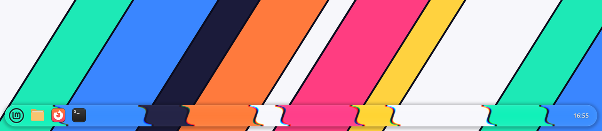

# Vitrin

Floating, rounded panels for Cinnamon, with an optional Molten Quartz background.

## Features

- **Floating panels.** Every panel is drawn as a rounded bar that floats a configurable distance away from the screen edge and the screen sides. The panel keeps its configured height; the gap is added around it.
- **Molten Quartz background.** The content behind the panel shows through, blurred, with refraction and colour fringing along the edges, a rim highlight and a soft shadow. Each part can be tuned or turned off. It can also be replaced by the theme's own panel colour.
- **Matching highlights.** Hovered, active and attention-seeking buttons get rounded highlights that stay inside the panel. The menu button can have a round one. The theme's Show Desktop bar is hidden until hovered.
- **Screen corners keep working.** Clicks in the empty space around the panel go to the nearest button, so throwing the pointer into a corner still opens the menu or shows the desktop.
- **Instant hide.** With an auto-hiding panel, the panel hides as soon as a window covers it instead of waiting for the hide delay. The delay still applies when the pointer leaves the panel.

## Settings

Open *System Settings → Extensions → Vitrin*.

| Section | Settings |
|---|---|
| Panel | Gap to the screen edge, side margins, inner padding (space between the panel's edge and its buttons; icons keep their size), corner radius |
| Background | Molten Quartz, or the theme's panel colour |
| Molten Quartz | Blur, edge refraction, lens width, colour fringing, rim highlight, frost, vibrancy, shadow strength, adapting icons and text to the background, icon and text shadows |
| Highlight | Corner radius, colour, round highlight for the menu button |
| Defaults | Restore defaults |
| Behaviour | Extend edge buttons to the screen edges; hide instantly when a window touches the panel |

## Notes

- For maximized windows to reach the bottom of the screen with the panel floating over them, set the panel to *Intelligently hide* or *Auto hide* in the panel settings.
- Desklets are not shown through the panel.
